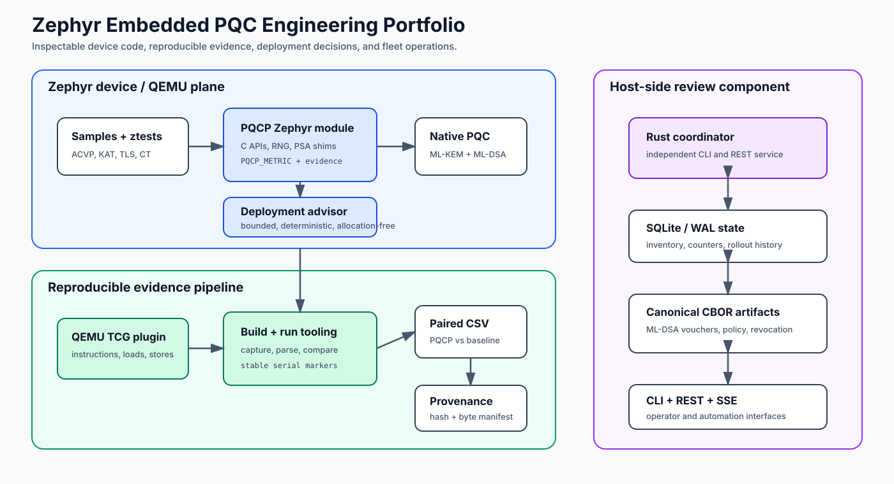

# Zephyr Embedded PQC Benchmarking

Zephyr RTOS module for benchmarking and validating embedded post-quantum cryptography. It integrates ML-KEM through `mlkem-native`, ML-DSA through `mldsa-native`, QEMU/board build targets, ACVP/KAT validation tests, timing-smoke checks, resource measurement, and reproducible CSV result exports.

This repository is a cleaned **public review version** of the workspace. It keeps the buildable implementation and verified result artifacts, while excluding generated build folders, temporary logs, virtual environments, old result duplicates, and planning notes.

## What this repo proves

- I can wire **native PQC backends** (`mlkem-native`, `mldsa-native`) into a Zephyr module with a clean C API, `west`/CMake build targets, and QEMU + real-board configs.
- I can build **validation, not just benchmarks**: ACVP-style serial command flows, **KAT** known-answer fixtures, and timing-smoke (constant-time) regression markers.
- I can express a **"cost-of-assurance"** methodology — paired PQCP-vs-baseline cycles/time/ROM/RAM — and make every result file hash-tracked in a manifest.

## Public scope (read before judging the numbers)

This is a **representative implementation** and **sanitized artifact**: source-visible for evaluation, not a certified module (see `LICENSE`). Public evidence is the QEMU primitive CSV plus build-only footprint rows; QEMU numbers are **regression/methodology evidence, not silicon performance**. The **ARM TrustZone-M / TF-M secure-world overhead figures (~2% avg, 5.5% worst)** quoted on my CV come from the **private** trusted-execution work and are **not** restated as public results here.

## Reviewer guide — start here

1. Open [`results/final/validated_primitive_benchmarks_qemu.csv`](results/final/validated_primitive_benchmarks_qemu.csv) and `results/summaries/results_summary.csv` — no build required.
2. Skim the validation paths under `tests/` (ACVP serial, KAT, CT smoke, TLS selftest).
3. Optional: `./scripts/build.sh tests/ztest_primitive qemu_x86_64 build-ztest-primitive` then `west build -d build-ztest-primitive -t run`.

**CV → this repo:** supporting evidence for *"ARM TrustZone-M / TF-M trusted-execution layer"* and embedded PQC validation. The validation harness and cost-of-assurance method are public; the secure-world enclave measurements are private.

## Overview

The project answers a practical embedded-security question: what does it cost to run PQC primitives and PQC-flavored protocol paths inside Zephyr, and how can the result be checked by another reviewer?

The module provides:

- ML-KEM wrappers and samples for key generation, encapsulation, and decapsulation.
- ML-DSA wrappers and samples for key generation, signing, verification, and streaming-message signing.
- ACVP-style serial command parsing for validation-oriented keygen/encap/decap/sign/verify flows.
- KAT tests using checked-in known-answer fixtures for ML-KEM and ML-DSA.
- Benchmark output through stable `PQCP_METRIC` rows.
- Evidence markers for build manifest, provider contract, firmware policy, capability descriptor, firmware scorecard, assurance status, and replayable transcript checks.
- Result analysis scripts that export paired PQCP-vs-baseline CSV summaries.

## Architecture



At runtime, samples and tests call the PQCP Zephyr module, which wraps the native PQ Code Package implementations. Benchmark and validation samples emit serial markers. Python tooling builds Zephyr targets with `west`, captures QEMU or board output, parses `PQCP_METRIC` rows, and writes compact CSV artifacts.

## Supported Algorithms And Targets

Algorithms:

- ML-KEM-512, ML-KEM-768, ML-KEM-1024 via `mlkem-native`.
- ML-DSA-44, ML-DSA-65, ML-DSA-87 via `mldsa-native`.

Validation paths:

- `tests/ztest_primitive`: primitive API checks.
- `tests/ztest_acvp_serial`: ACVP-style serial command checks.
- `tests/ztest_acvp_kat`: known-answer fixture checks.
- `tests/ztest_ct_smoke`: timing-smoke regression markers for ML-KEM decapsulation.
- `tests/ztest_tls_selftest`: TLS/protocol metric smoke output.

Targets represented in the included results:

- `qemu_x86_64`: runnable QEMU benchmark and validation target.
- `nucleo_h743zi`: build-only protocol footprint result.
- `mps2/an385`: build/resource profile coverage result.

QEMU numbers are regression and methodology evidence, not physical board performance claims.

## Requirements

- Python 3.12 or newer.
- Zephyr `west`.
- Zephyr SDK 1.0.1.
- Zephyr revision from `west.yml`.
- `git`.
- `qemu-system-x86_64` for QEMU runs.

Initialize dependencies either with west or submodules:

```bash
west init -l .
west update
west zephyr-export
```

For standalone module development, the native backend submodules can also be initialized:

```bash
git submodule update --init --recursive
```

## Build

Build a primitive validation target:

```bash
./scripts/build.sh tests/ztest_primitive qemu_x86_64 build-ztest-primitive
```

Equivalent raw west command:

```bash
west build -p always -b qemu_x86_64 tests/ztest_primitive -d build-ztest-primitive
```

## Run

Run the built QEMU target:

```bash
west build -d build-ztest-primitive -t run
```

Run a compact benchmark export into `results/local/`:

```bash
./scripts/run_benchmark.sh
```

Analyze the trusted final primitive benchmark CSV:

```bash
python3 scripts/analyze_results.py results/final/validated_primitive_benchmarks_qemu.csv
```

## Results Summary

Trusted final primitive benchmark source:

```text
results/final/validated_primitive_benchmarks_qemu.csv
```

Summary table:

```text
results/summaries/results_summary.csv
```

Included result artifacts:

- `results/final/validated_primitive_benchmarks_qemu.csv`: paired PQCP vs baseline primitive cycles, time, ROM, RAM on `qemu_x86_64`.
- `results/final/benchmark_provenance.json`: hash and generation metadata for the trusted primitive CSV.
- `results/final/validated_cost_of_assurance_primitives_qemu.csv`: compact primitive cost-of-assurance rows.
- `results/final/validated_cost_of_assurance_protocols_qemu.csv`: compact TLS/protocol cost-of-assurance rows.
- `results/final/validated_cost_of_assurance_builds_qemu.csv`: build-size companion rows for QEMU cost-of-assurance runs.
- `results/final/validated_profile_resource_metrics.csv`: sanitized cross-profile resource metrics with local paths removed.
- `results/final/validated_nucleo_protocol_footprint_build_only.csv`: build-only protocol footprint rows for `nucleo_h743zi`.
- `results/summaries/included_results_manifest.csv`: SHA-256 hashes for included public result files.
- `results/summaries/result_artifact_audit.csv`: concise include/exclude audit for CSV/result sources.

## Reproducibility Notes

- The benchmark tooling captures `PQCP_METRIC` serial rows and converts them to CSV using `scripts/parse_logs.py` and `scripts/export_results.py`.
- The final primitive CSV was selected from release-check output because it has paired PQCP/baseline rows and a provenance sidecar.
- Build directories, raw logs, generated Doxygen HTML, local virtual environments, and duplicate CSVs are intentionally excluded.
- QEMU measurements are useful for regression and comparison methodology. Physical performance claims require board-run evidence.

## Limitations

- Included `nucleo_h743zi` rows are build-only footprint measurements, not UART runtime benchmark measurements.
- Energy is not included because it was not measured in the retained final artifacts.
- Timing-smoke and CT markers are regression evidence only; they are not formal constant-time proofs.
- This repository is source-visible for portfolio and evaluation use, but it is not open source. See `LICENSE`.
