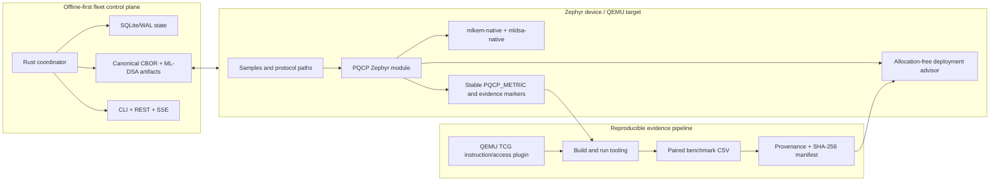

# Architecture

The public repository exposes a representative vertical slice of a larger
embedded PQC trust stack. It keeps the boundaries visible: cryptography,
measurement, evidence-aware deployment decisions, and fleet operations are
separate components with explicit artifacts between them.

## Device boundary

The Zephyr module owns C APIs, configuration, and stable serial markers. The
native algorithm packages remain separate dependencies. This keeps provider
selection and algorithm implementation distinct from the benchmark and
evidence layers.

The deployment advisor consumes caller-owned facts; it does not execute
cryptography or allocate memory. Hard budget and policy failures become
blocker bits. Missing validation or measurement inputs become evidence gaps.
Only feasible candidates are ranked, and the same inputs produce the same
ordering and next-experiment plan.

## Evidence boundary

Benchmark runs emit stable rows that are parsed into paired PQCP/baseline CSV
records. The retained public dataset is bound to a provenance sidecar and an
artifact manifest. `scripts/verify_public_artifacts.py` checks hashes, byte
counts, row counts, pairing, and algorithm coverage without requiring a Zephyr
toolchain.

The TCG plugin adds instruction, load, and store counts for marked firmware
regions. Its output is regression evidence, not a formal constant-time claim.

## Fleet boundary

The Rust coordinator is deliberately host-side. It keeps inventory and rollout
state in SQLite/WAL, protects its local ML-DSA root at rest, and exposes the
same issuance service through offline CLI and connected REST paths. Canonical
CBOR artifacts are the protocol boundary; private key material is not passed
to the device-facing API.

## Failure semantics

- Malformed scenarios and candidates fail before ranking.
- Budget or policy violations remain visible as rejected candidates.
- Missing evidence creates a conditional result and a prioritized experiment.
- Result-file drift fails hash and provenance verification.
- Rollout threshold or deadline violations transition to rollback states.
- The public documentation keeps simulation, build-only, and hardware evidence
  labelled separately.
